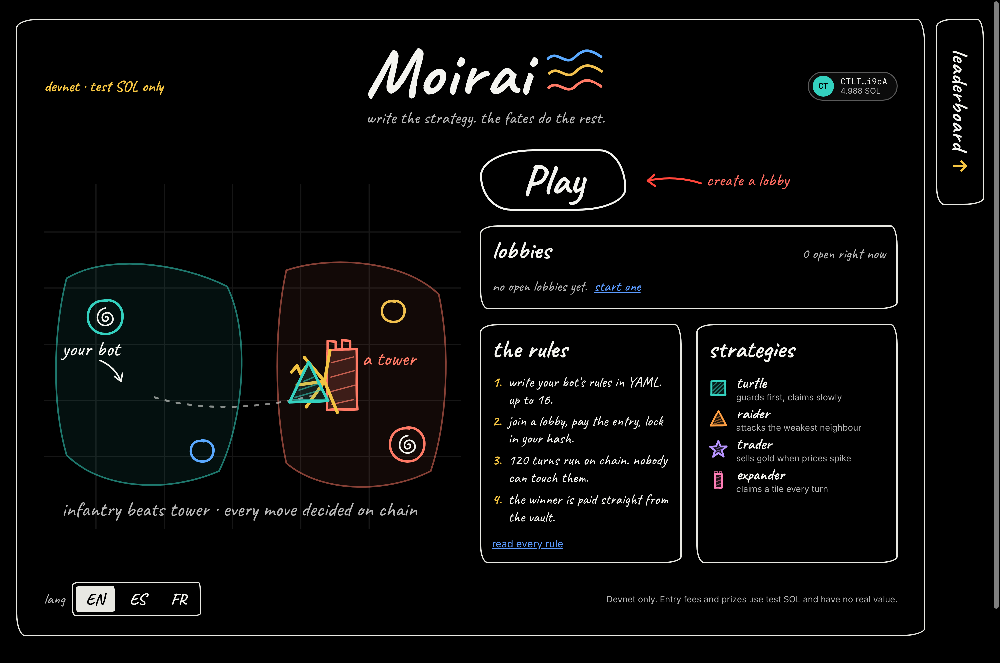
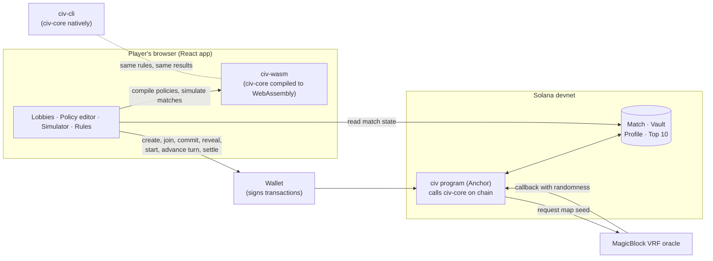
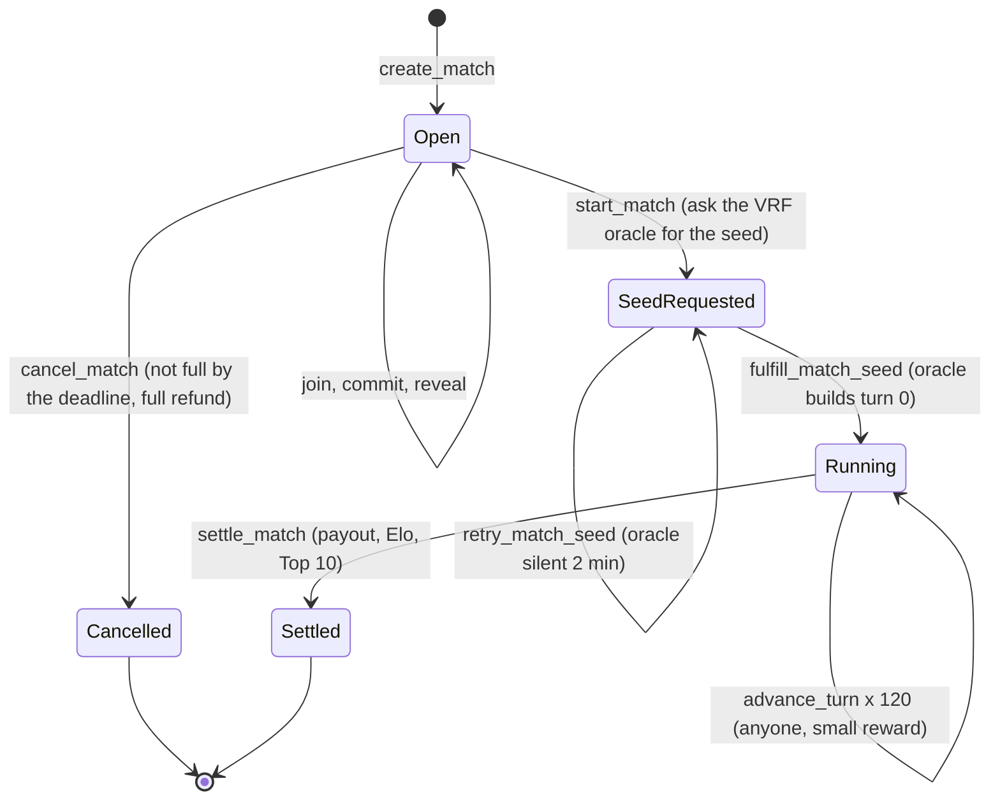
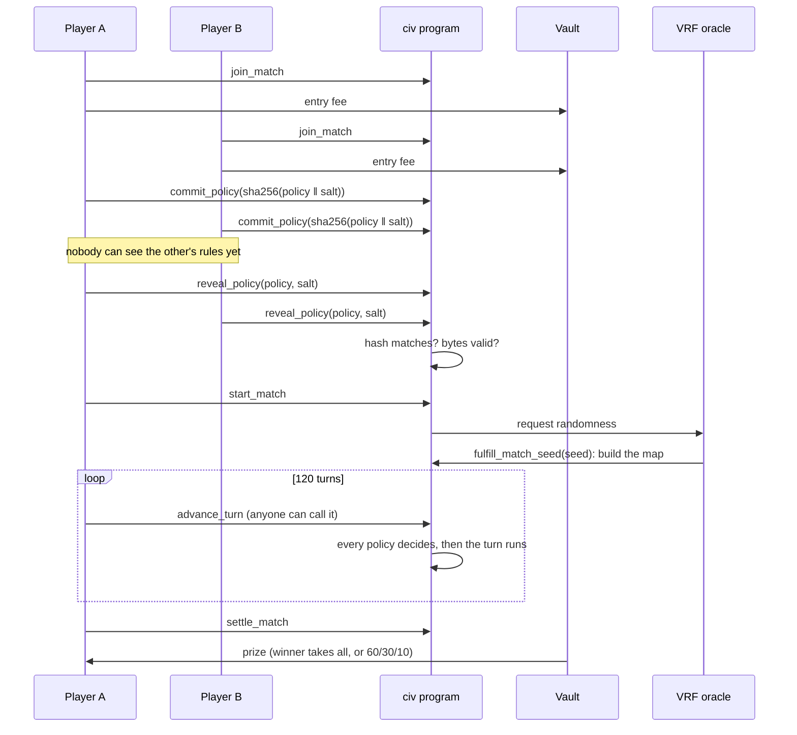
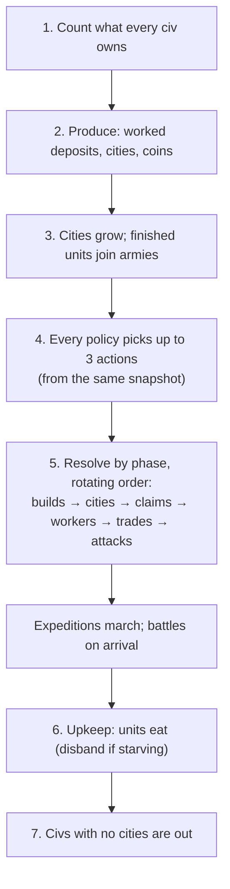

# Moirai

**An on-chain bot arena on Solana.** Players write a strategy for an AI civilisation in a few lines
of YAML, pay an entry fee, and let their bots fight for land and resources on a shared map for 120
turns. The Solana program is the referee, the bank and the scoreboard: it runs every policy itself,
holds the prize pool in a vault, pays the winners and keeps the leaderboard.

> In Greek myth the Moirai are the three Fates, who spin, measure and cut the thread of every life.
> Here, players spin their strategy, the chain measures every turn, and nobody can cut in.

<!-- Screenshot of the app's home page: save it as assets/home.png (or change this path). -->


**Devnet program:** [`GPdm56hssFExZrtGspZprjbfecXbRKYtAJGQ4X1ysNkc`](https://explorer.solana.com/address/GPdm56hssFExZrtGspZprjbfecXbRKYtAJGQ4X1ysNkc?cluster=devnet)

---

## A note from me

This is my **first MLH hackathon and my first Solana hackathon**. I came in knowing React and
TypeScript, and almost nothing about Rust or Solana. I wanted a project that needed a blockchain
for a real reason rather than as decoration, and a game where the rules themselves are the thing
you trust turned out to be exactly that. Learning Rust by writing a deterministic game engine,
then watching the same engine run on chain, in the browser and in a terminal and give the exact
same answer every time, was the most interesting part. It was a lot of fun.

## Why I built it

Bot competitions today run on somebody's server. Players have to trust whoever runs it with the
rules, the results and the prize money: that the organiser didn't peek at strategies, tweak a
result, or walk off with the pot. I wanted a game where **nobody, including me, controls the
outcome**.

## Why it needs Solana, not a server

- **The program plays the game.** Bots never send moves: the program executes every policy each
  turn, so nobody can choose moves or rig a match.
- **The prize pool is held by code.** Entry fees go into a program-controlled vault that only
  settlement (or a refund) can pay out from. Not even the lobby creator can withdraw.
- **Commit, then reveal.** Players first post only a hash of their policy and reveal it once
  everyone has committed, so nobody can copy or counter a policy after seeing it.
- **Anyone can check a result.** The same engine runs in the browser, so any match can be replayed
  from its seed and policies and compared with the chain, byte for byte.
- **It's cheap.** A whole turn for every civ is one transaction, and in-game resources are numbers
  in an account, not token transfers.

> The entry fee is what you pay for a referee nobody owns.

---

## How the game works

**The map.** A 16 × 16 grid for 2 to 4 civilisations, generated from a random seed drawn by a VRF
oracle *after* every policy is locked in, so nobody can tune a bot to the map. One quarter is
generated and mirrored into the others, so every civ starts with exactly the same surroundings.

**Economy.** Three resources: Food, Ore and Gold, plus coins. Deposits produce only while a Worker
works them; cities produce a base income and coins every turn. A shared market prices each
resource by supply (sell a lot and the price falls), and every trade loses 5% to the spread so
trading back and forth never makes money.

**Cities and borders.** Every civ starts with a capital. Cities grow and push their borders out
until they meet a neighbour's; after that, land only changes hands by buying tiles or by war.
Settlers found new cities on city sites.

**Armies that march.** Six units: Infantry, Guard, Siege and Elite fight in a rock-paper-scissors
loop; Settlers and Workers don't fight. `attack` sends the whole army out as an expedition that
marches through any land (Infantry and Elite 2 tiles a turn, Guard and Siege 1) to a border tile,
a city or **the enemy capital**, and fights when it arrives. Win and the city is captured or razed
and its stockpile plundered; lose the capital and your largest city takes over; lose every city
and you are out.

**Winning.** The lobby creator picks one win metric: **Territory** (most tiles), **Wealth** (coins
plus resources at the final market prices), **Conquest** (last civ standing) or **Score** (a mix
of land, wealth and army). Ties split the prize. The payout is winner-takes-all or 60/30/10.

The full rules are in the app's **Rules** page, in English, Spanish and French.

### Policies: you write the strategy, the chain plays it

A policy is an ordered list of up to 16 if/then rules. Each turn the **first 3 rules whose
condition is true** act. This is the sample `red-raider` bot:

```yaml
name: red-raider
rules:
  - if: my.workers < 3
    do: build(worker)
  - if: my.army >= 14 and my.siege >= 3 and my.army > 150% nearest_enemy.army
    do: attack(nearest_enemy, capital)
  - if: my.army >= 8 and my.army > 200% weakest_neighbor.army
    do: attack(weakest_neighbor, border)
  - if: ore >= 10 and gold >= 10 and my.siege < 5
    do: build(siege)
  - if: food >= 10
    do: build(infantry)
  - if: gold > 30
    do: sell(gold, 15)
```

The YAML is compiled to a few bytes per rule (at most 499 bytes for a whole policy). Those bytes
are what a player commits to, reveals, and what the program runs every turn. Conditions read
resources, prices, armies, distances and the turn number; actions build units, found cities, buy
land, assign workers, trade, rush a build with coins, and attack (`weakest_neighbor`,
`strongest_neighbor`, `nearest_enemy`, `richest_enemy`, `largest_enemy` or `leader`, aiming at a
`border`, `city` or `capital`).

Four sample bots with different styles live in [`policies/`](policies/): **iron-turtle**
(defence and land), **red-raider** (conquest), **silk-trader** (wealth) and **wide-expander**
(cities).

---

## Architecture

The most important idea: **the game rules are written once**, in a plain Rust crate (`civ-core`)
with no Solana code in it. The Solana program calls it on chain, the browser runs the same crate
compiled to WebAssembly, and the command-line tool runs it natively. One source of truth means the
browser can never disagree with the chain, and tests check that all three give the same
fingerprint for the same match.



### Accounts

| Account | Holds | Address (PDA seeds) |
| --- | --- | --- |
| **Match** | Lobby settings, players, policy commitments, revealed policies, and the whole game state (map, civs, market), 3.7 KB, zero-copy | `match`, creator, match id |
| **Vault** | The entry fees (lamports); paid out only by `settle_match` or `cancel_match` | `vault`, match |
| **Profile** | A wallet's Elo, matches, wins and winnings | `profile`, wallet |
| **Top 10** | The ten best Elo ratings | `top10` |

The plan had separate Civ, Map and Market accounts. Measuring showed the whole game fits in one
account, which makes each turn read and write a single account.

### A match, from lobby to payout





**Money only ever leaves the vault two ways:** a full refund if the lobby never fills, or the
payout at settlement. A player who commits but never reveals forfeits their fee to the pool and
their civ sits idle, which stops people joining, seeing who else is in, and backing out.

### One turn

Every civ decides from the same start-of-turn state, then everything resolves together in an order
that rotates each turn, so no civ always wins ties.



### Measured on devnet

| What | Result |
| --- | --- |
| Lobby, 2 joins, 2 commits, 2 reveals | about 9 s |
| `start_match` → VRF seed delivered and turn 0 built | about 2.6 s |
| One `advance_turn` for every civ | 40k–90k compute units (the limit is 1.4M) |
| A full 120-turn match on the base layer | about 3.3 minutes (1.7 s a turn) |
| On-chain final state vs a native replay of the same seed | identical, byte for byte |

---

## Tech stack

| Layer | What we use |
| --- | --- |
| Game rules | Rust (pinned 1.89), `bytemuck` for zero-copy plain-bytes state; integer maths only (no floats), deterministic randomness from the match seed |
| On-chain program | Anchor 1.0.2 on Solana (Agave 3.1.14), devnet only; MagicBlock `ephemeral-rollups-sdk` 0.16.2 for VRF randomness (and rollups, next) |
| Browser engine | `wasm-bindgen` + `wasm-pack`: civ-core compiled to WebAssembly |
| Frontend | React 19, TypeScript 5.9 (strict), Vite 8, styled-components 6, React Router 8, TanStack Query 5 |
| Wallet and chain client | Solana wallet adapter, `@solana/web3.js` 1.x, `@anchor-lang/core` 1.0.2 (typed client from the IDL) |
| Languages | `typesafe-i18n`: English, Spanish and French |
| Testing | `cargo test` (200+ engine tests), Anchor integration tests on Surfpool, Vitest + React Testing Library, plus a devnet end-to-end script |
| Tooling | pnpm workspace, oxlint, Prettier, clippy, rustfmt |

---

## Project structure and important files

```
moirai/
├── crates/
│   ├── civ-core/     all game rules (shared by program, browser and CLI)
│   ├── civ-wasm/     WebAssembly wrapper, no logic
│   └── civ-cli/      play matches in the terminal
├── programs/civ/     the Solana program (Anchor)
├── app/              the React app
├── tests/            program integration tests (+ tests/devnet for real devnet runs)
└── policies/         the four sample bots
```

| File | Why it matters |
| --- | --- |
| [`crates/civ-core/src/turn.rs`](crates/civ-core/src/turn.rs) | One whole turn, step by step: the best place to start reading |
| [`crates/civ-core/src/rules.rs`](crates/civ-core/src/rules.rs) | Every number in the game: costs, speeds, growth, market, battles |
| [`crates/civ-core/src/march.rs`](crates/civ-core/src/march.rs) | Expeditions: sending armies out and battles on arrival |
| [`crates/civ-core/src/policy/`](crates/civ-core/src/policy/) | Policy language: compiled byte format, YAML compiler, interpreter |
| [`crates/civ-core/tests/sample_bots_match.rs`](crates/civ-core/tests/sample_bots_match.rs) | The determinism gate: a full match is identical every time |
| [`programs/civ/src/lib.rs`](programs/civ/src/lib.rs) | Every instruction the program accepts |
| [`programs/civ/src/instructions/advance_turn.rs`](programs/civ/src/instructions/advance_turn.rs) | Plays one turn on chain by calling civ-core |
| [`programs/civ/src/instructions/settle_match.rs`](programs/civ/src/instructions/settle_match.rs) | Scoring, payouts, Elo and the Top 10 |
| [`programs/civ/src/state/match_account.rs`](programs/civ/src/state/match_account.rs) | The zero-copy Match account |
| [`app/src/lib/solana/`](app/src/lib/solana/) | The only place the app talks to Solana |
| [`app/src/lib/engine/`](app/src/lib/engine/) | The only place the app talks to the WebAssembly engine |
| [`app/src/pages/LobbyPage/`](app/src/pages/LobbyPage/) | Join, commit, reveal, start, play and settle from the browser |
| [`tests/advance-turn.ts`](tests/advance-turn.ts) | A full match on a local validator, checked against the native result |
| [`tests/devnet/full-match.ts`](tests/devnet/full-match.ts) | A full match on devnet with the real VRF oracle |

---

## Run it

You need the toolchain from [Installation in detail](#installation-in-detail) (Rust, the Solana
CLI, Anchor 1.0.2, Node 24 with pnpm, wasm-pack, Surfpool).

```sh
pnpm install
pnpm build:wasm        # build the WebAssembly engine the app uses
pnpm dev               # open http://localhost:5173
```

The app talks to the program already deployed on devnet. Connect a wallet set to **devnet** (with a
little devnet SOL from <https://faucet.solana.com>), then:

1. **Simulator**: run your policy against the sample bots in the browser, free, and watch the match
   play back like a video.
2. **Policy editor**: write a policy; it is checked by the real compiler as you type.
3. **Create lobby**: pick the win metric, entry fee, players and deadlines.
4. **Lobby**: join, commit a policy, reveal, start the match, play the turns and settle. Use a
   second wallet (another browser) as the other player. Playing the turns from the browser asks
   your wallet to approve each turn; the crank script (Phase 3) will do this for you.

Without the app:

```sh
cargo run -p civ-cli -- play             # watch the four sample bots play in the terminal
cargo run -p civ-cli -- play 7 --quiet   # another seed, just the result and a war summary
cargo test --workspace                   # engine and program unit tests
pnpm test:program                        # the program on a local Surfpool validator
pnpm test                                # the app's tests
pnpm devnet:match                        # a real match on devnet (spends ~0.06 devnet SOL)
```

---

## Status

| Phase | State |
| --- | --- |
| 0 · Setup and spikes (wallet, devnet deploy, MagicBlock rollup and VRF) | ✅ done |
| 1 · Game engine (civ-core), sample bots, CLI, WebAssembly build | ✅ done |
| 2 · On-chain program: lobby, vault, commit-reveal, VRF start, turns, settlement, Profiles, Top 10 | ✅ done, running on devnet |
| 3 · Turns in a MagicBlock ephemeral rollup, crank script | 🔜 next (the delegation spike already works) |
| 4 · App: lobbies, create, lobby flow, editor, simulator, rules | ✅ done · match viewer, replay, leaderboard from chain: in progress |

**Ideas for after the hackathon:** fog of war (private state in a rollup), diplomacy enforced by
the program, a policy marketplace (the on-chain hash proves who wrote a bot first), seasons and
tournaments, artifacts minted to winners, shareable lobby links (Solana Actions), and an AI that
turns a plain-English strategy into YAML.

---

## Installation in detail

### Toolchain

These are the pinned versions. Anchor and Solana are pinned to what the MagicBlock Ephemeral
Rollups and VRF SDKs are tested against; don't upgrade them without checking compatibility first.

| Tool | Version | Notes |
| --- | --- | --- |
| Rust (rustup) | stable (1.99.1) | plus the `wasm32-unknown-unknown` target |
| Solana CLI (Agave) | 3.1.14 | |
| Anchor CLI (via AVM) | 1.0.2 | |
| Node.js | 24.22.2 (LTS) | pinned in `.node-version` |
| pnpm | 12.18.0 | via corepack |
| wasm-pack | 0.15.1 | |
| GitHub CLI `gh` | any | optional |

### Steps

These steps are for macOS (Apple Silicon or Intel). On Windows, install WSL2 (Ubuntu) and run
everything inside it. On Linux/WSL, first install the build dependencies:

```sh
sudo apt-get update
sudo apt-get install -y build-essential pkg-config libudev-dev llvm libclang-dev protobuf-compiler libssl-dev
```

### 1. Build tools (macOS)

```sh
xcode-select --install   # skip if Xcode or the Command Line Tools are already installed
```

### 2. Rust

```sh
curl --proto '=https' --tlsv1.2 -sSf https://sh.rustup.rs | sh -s -- -y
. "$HOME/.cargo/env"
rustup target add wasm32-unknown-unknown
```

### 3. Solana CLI (Agave)

```sh
sh -c "$(curl -sSfL https://release.anza.xyz/v3.1.14/install)"
```

The installer adds Solana to your PATH in `~/.zprofile` / `~/.profile`. Restart your terminal, or
run this in the current one:

```sh
export PATH="$HOME/.local/share/solana/install/active_release/bin:$PATH"
```

### 4. Anchor CLI via AVM

```sh
cargo install --git https://github.com/solana-foundation/anchor --tag v1.0.2 avm --force --locked
avm install 1.0.2
avm use 1.0.2
```

This compiles from source and takes a few minutes. Ignore AVM's "new version available" notice;
we are pinned to 1.0.2 on purpose.

### 5. wasm-pack

```sh
cargo install wasm-pack --version 0.15.1 --locked
```

### 6. Node.js and pnpm

Use a Node version manager. These steps use [fnm](https://github.com/Schniz/fnm); nvm works too.
The repo's `.node-version` pins Node 24.

```sh
# in the repo root
fnm install          # reads .node-version
fnm use
corepack enable pnpm
corepack prepare pnpm@12.18.0 --activate
```

With `eval "$(fnm env --use-on-cd --shell zsh)"` in your `~/.zshrc`, fnm switches Node
automatically when you `cd` into the repo.

### 7. Surfpool (local validator for `anchor test`)

Anchor 1.0 runs tests on [Surfpool](https://github.com/solana-foundation/surfpool) by default.

```sh
curl -sL https://run.surfpool.run/ | bash   # installs to ~/.local/bin and adds it to your PATH
```

Don't use `cargo install surfpool`: that crates.io name belongs to an unrelated crate.

### 8. Verify

Open a new terminal, then:

```sh
rustc --version && cargo --version
rustup target list --installed   # should include wasm32-unknown-unknown
solana --version
anchor --version
surfpool --version
wasm-pack --version
node --version && pnpm --version
```

### 9. Solana CLI: devnet and a wallet keypair

```sh
solana config set --url https://rpc.magicblock.app/devnet   # devnet via MagicBlock's RPC (see "Devnet" below)
solana-keygen new --outfile ~/.config/solana/id.json   # only if you don't already have one
```

`solana-keygen new` prints a seed phrase. **Write it down offline and never commit it, paste it
anywhere or share it.** Then fund the wallet with devnet SOL:

```sh
solana address
solana airdrop 2
```

If the airdrop is rate-limited, use the web faucet at <https://faucet.solana.com> with the address
printed by `solana address`.

## Development reference

### Repo layout

| Folder | What it is |
| --- | --- |
| `crates/civ-core` | All game rules, plain Rust, no Solana dependencies |
| `crates/civ-wasm` | wasm-bindgen wrapper so the browser can run civ-core |
| `crates/civ-cli` | Runs local matches between YAML bots |
| `programs/civ` | The Anchor (Solana) program |
| `app` | React + TypeScript + Vite frontend |
| `tests` | Anchor integration tests (TypeScript, mocha) |
| `scripts/crank` | Calls `advance_turn` (Phase 3, not built yet) |
| `policies` | The four sample YAML bots (also test fixtures) |

### Commands

Run from the repo root:

```sh
pnpm install                          # JS dependencies for app, tests and scripts

cargo build --workspace               # build all Rust crates
cargo test --workspace                # test all Rust crates
cargo run -p civ-cli -- play          # play the 4 sample bots for a full 120-turn match
cargo run -q -p civ-cli -- compile policies/raider.yaml   # a policy's compiled bytes, as hex
pnpm build:wasm                       # build civ-wasm into crates/civ-wasm/pkg

anchor build                          # build the program (+ IDL and TS types in target/)
pnpm sync:idl                         # copy that IDL + types into the app (after every anchor build)
pnpm test:program                     # build with local-testing, run tests/ on Surfpool, rebuild for deploy

pnpm dev                              # app dev server on localhost:5173
pnpm lint && pnpm typecheck && pnpm test
```

Add `--validator legacy` to `anchor test` to use `solana-test-validator` instead of Surfpool.
Deploying is covered in the Devnet section below.

## Devnet

| | |
| --- | --- |
| Program ID | `GPdm56hssFExZrtGspZprjbfecXbRKYtAJGQ4X1ysNkc` (the full match program, last upgraded 2026-11-08, slot 520055154) |
| Cluster | devnet only (never mainnet) |
| RPC we use | `https://rpc.magicblock.app/devnet` |
| Explorer | [program on Solana Explorer](https://explorer.solana.com/address/GPdm56hssFExZrtGspZprjbfecXbRKYtAJGQ4X1ysNkc?cluster=devnet) |

### Which RPC, and why

We use **MagicBlock's devnet RPC** (`https://rpc.magicblock.app/devnet`) for deploying, the CLI and
the app. It is real Solana devnet (same genesis hash as `api.devnet.solana.com`), just less
congested. The public `api.devnet.solana.com` rate-limits hard (HTTP 429): a 147 KB deploy needs
about 150 write transactions, and through the public RPC it stalled at 0% and then failed with
`Data writes to account failed: Max retries exceeded`. It's also the base-layer RPC MagicBlock's
docs use, so it fits the Ephemeral Rollups work in Phase 3.

Point the Solana CLI at it once:

```sh
solana config set --url https://rpc.magicblock.app/devnet
```

The app reads `VITE_SOLANA_RPC_URL` (see `app/.env.example`, which defaults to the same RPC).

### Deploy the program

```sh
anchor build
solana program deploy target/deploy/civ.so \
  --program-id target/deploy/civ-keypair.json \
  --url https://rpc.magicblock.app/devnet \
  --max-sign-attempts 50 --with-compute-unit-price 10000
solana program show GPdm56hssFExZrtGspZprjbfecXbRKYtAJGQ4X1ysNkc --url https://rpc.magicblock.app/devnet
```

- The first deploy costs about 1 SOL of rent (for a 147 KB program). Redeploying the same program ID
  is an upgrade and reuses it.
- `--max-sign-attempts 50` lets the CLI re-send dropped writes instead of giving up;
  `--with-compute-unit-price 10000` adds a tiny priority fee so writes land sooner.
- `target/deploy/civ-keypair.json` is the program's keypair. It's gitignored; never commit it.

### If a deploy fails or you stop it

The upload goes into a temporary **buffer** account that holds the SOL. Get it back with:

```sh
solana program show --buffers --url https://rpc.magicblock.app/devnet
solana program close --buffers --url https://rpc.magicblock.app/devnet
```

Then run the deploy again.

## Phase 0 spikes: MagicBlock Ephemeral Rollup + VRF

Both passed on devnet (2026-11-08) with Anchor 1.0.2 and `ephemeral-rollups-sdk` 0.16.2.

```sh
pnpm spike:magicblock     # runs tests/devnet/magicblock-spike.ts against devnet with your CLI wallet
```

| Step | Measured |
| --- | --- |
| Delegate an account to the rollup (base layer) | ~1.3 s, router sees it +0.6 s |
| Transaction inside the rollup (`increment`) | ~0.37 s, fee 0 |
| Commit + undelegate, visible again on Solana | ~0.4 s + 2.4 s |
| VRF request (base layer) → oracle callback | ~1.2 s + 1.3 s |

So a 120-turn match in the rollup would take under a minute and cost nothing in fees; one VRF seed per match
arrives in about a second. The script spends a tiny amount of devnet SOL (~0.006 on the first run).

Endpoints: base `https://rpc.magicblock.app/devnet`, router `https://devnet-router.magicblock.app/`,
rollup `https://devnet-eu.magicblock.app/` (override with `ER_RPC=...`).
